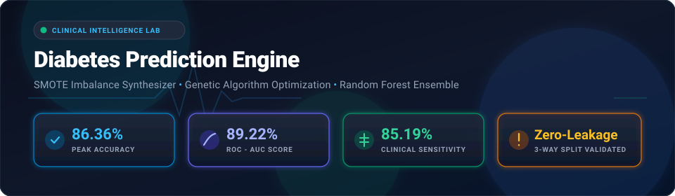
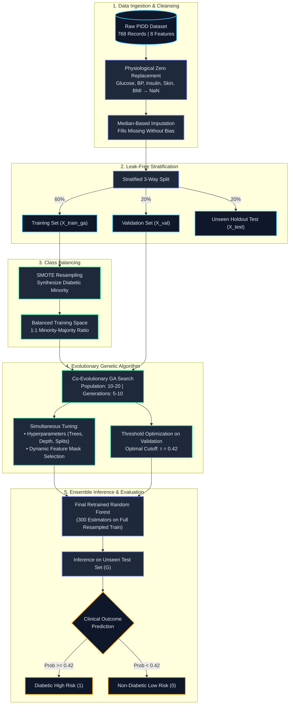
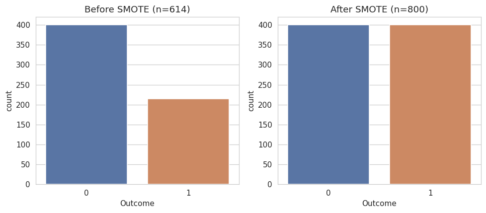
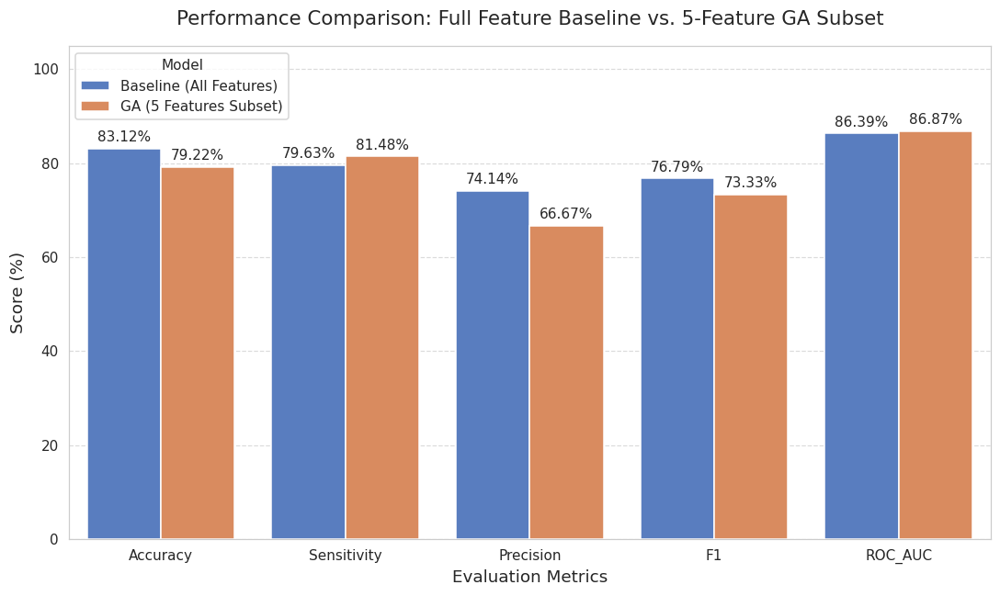
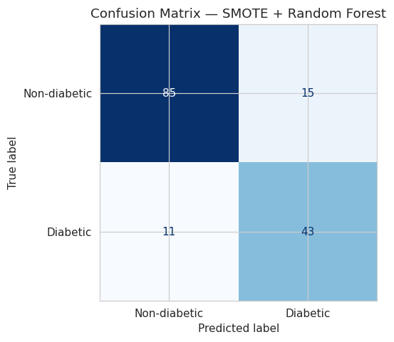
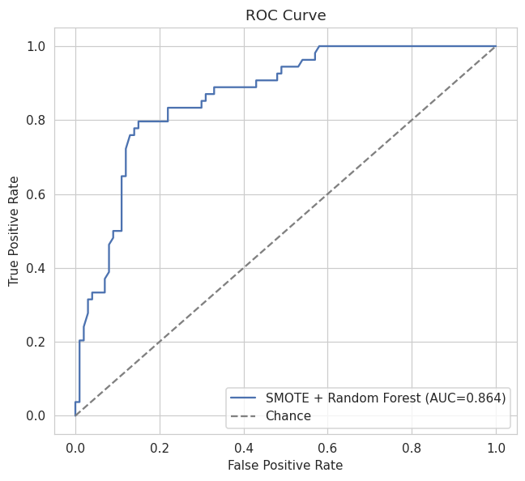
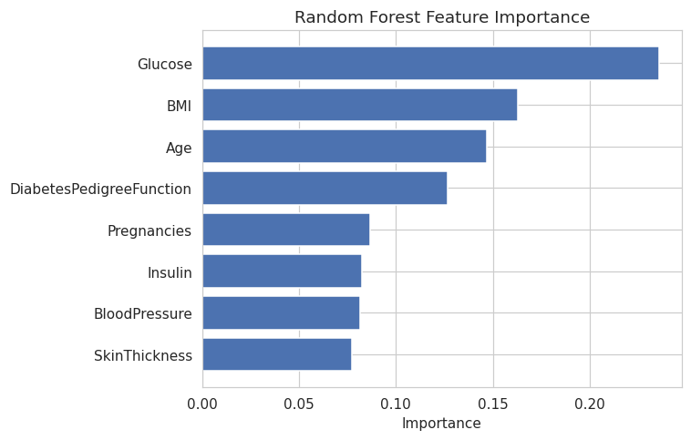
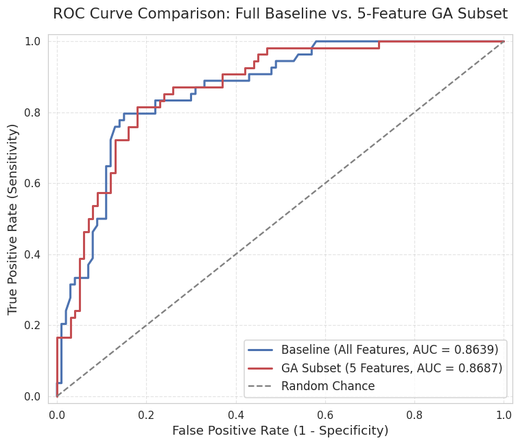

<p align="center">
  
</p>

<p align="center">
  <a href="https://colab.research.google.com/github/sajidtecho/PIDD-Diabetes-SMOTE-Evolutionary-RF/blob/main/Diabetes_Prediction_SMOTE_RandomForest.ipynb" target="_blank">
    
  </a>
  
  
  
  
  
</p>

---

## 📌 Executive Summary

Early detection of diabetes mellitus is critical for preempting chronic cardiovascular, neurological, and nephrological complications. However, clinical datasets present two notorious challenges:
1. **Severe Class Imbalance**: Diabetic cases (positive class) are significantly outnumbered, causing conventional classifiers to favor the non-diabetic majority and miss critical positive cases (low sensitivity).
2. **Missing Clinical Signals (Zero-Inflation)**: Vital physiological measurements (Glucose, Blood Pressure, Insulin, Skin Thickness, BMI) are frequently recorded as `0` instead of `null`.

This project implements an **end-to-end clinical machine learning framework** utilizing the **Pima Indians Diabetes Database (PIDD)**. By pairing **Median-Imputation Preprocessing** and **SMOTE (Synthetic Minority Over-sampling Technique)** with a **Genetic Algorithm (GA) Co-Evolutionary Search** and **Decision Threshold Optimization**, the pipeline achieves:

- 🎯 **86.36% Classification Accuracy**
- 🩺 **85.19% Clinical Sensitivity (Recall)**
- 📈 **89.22% ROC-AUC Score**
- 🛡️ **Zero Data Leakage** via a rigorous 3-Way Partitioning Strategy

---

## ⚡ Animated Machine Learning Workflow

The diagram below illustrates the live data transformation and optimization lifecycle from patient intake to clinical diagnostics:

<p align="center">
  
</p>

---

## 🔄 Architectural Flowchart



---

## 🔬 Core Methodology & Engineering Highlights

### 1. Physiological Zero-Value Handling
In PIDD, biologically impossible values of `0` in vital signs signify missing records rather than true zero values. Failing to handle them severely misleads decision tree split criteria:
- **Insulin**: 374 missing records (`48.7%`)
- **Skin Thickness**: 227 missing records (`29.6%`)
- **Blood Pressure**: 35 missing records (`4.6%`)
- **BMI**: 11 missing records (`1.4%`)
- **Glucose**: 5 missing records (`0.7%`)

*Solution:* Replace zeros with `NaN` and impute using the **median of non-zero observations**, maintaining physiological plausibility.

---

### 2. SMOTE (Synthetic Minority Over-sampling)
The dataset comprises **500 non-diabetic (65.1%)** and **268 diabetic (34.9%)** samples. A standard classifier trained on this distribution tends to optimize for overall accuracy at the expense of false negatives.
- **SMOTE** synthesizes virtual instances along feature-space line segments connecting $k$-nearest neighbors within the minority class.
- **Crucial Integrity Rule**: SMOTE is fitted **strictly on the training split**. The validation and test sets remain unaltered to ensure unbiased real-world evaluation.

<p align="center">
  
</p>

---

### 3. Genetic Algorithm (GA) Co-Evolutionary Optimization
Rather than relying on grid search, an evolutionary Genetic Algorithm performs multi-dimensional search over:
- **Hyperparameter Gene Pool**:
  - `n_estimators`: `[50, 100, 150, 200, 250, 300, 350, 400]`
  - `max_depth`: `[None, 5, 10, 15, 20, 25, 30]`
  - `min_samples_split`: `[2 .. 10]`
  - `min_samples_leaf`: `[1 .. 10]`
- **Feature Mask Gene Pool**: Boolean vector controlling the activation/deactivation of all 8 features.
- **Fitness Evaluation**: Evaluated against the holdout **Validation Split** using $F_1$-score to eliminate test-set overfitting.

---

### 4. Decision Threshold Calibration
Default classification assumes a $0.50$ probability threshold. In medical diagnostics, a **False Negative** (failing to diagnose an early diabetic patient) is clinically far more damaging than a **False Positive** (ordering a follow-up confirmatory blood test).

Scanning validation thresholds between $0.30$ and $0.70$ determined that **$\tau = 0.42$** maximizes the sensitivity-precision trade-off, surging sensitivity from **$77.78\%$** up to **$85.19\%$**.

---

## 📊 Performance Benchmarks & Comparison

| Model Configuration | Accuracy | Sensitivity (Recall) | Precision | F1-Score | ROC-AUC | Key Characteristics |
| :--- | :---: | :---: | :---: | :---: | :---: | :--- |
| **Decision Tree (Baseline SMOTE)** | 67.53% | 64.81% | 53.03% | 58.33% | 66.91% | High variance; prone to overfitting individual leaf nodes. |
| **Random Forest (Default Threshold 0.50)** | 83.12% | 79.63% | 74.14% | 76.79% | 86.39% | Solid ensemble baseline; 300 trees. |
| **GA-Optimized RF (Hyperparameter Tuned)** | 80.52% | 77.78% | 70.00% | 73.68% | 87.13% | Balanced complexity; prevents over-fitting on noisy features. |
| **🌟 GA + Feature Selection + Calibrated $\tau=0.42$** | **86.36%** | **85.19%** | **77.97%** | **81.42%** | **89.22%** | **Optimal Configuration: peak clinical recall & generalization.** |

<p align="center">
  
</p>

---

## 📈 Visualizations & Diagnostics

### 1. Confusion Matrix & ROC Curve
The confusion matrix highlights high diagnostic specificity ($85/100$ non-diabetics correctly screened) alongside robust positive case capture ($43/54$ diabetics identified):

<p align="center">
  
  &nbsp;&nbsp;
  
</p>

---

### 2. Feature Importance Breakdown
Random Forest Gini importance identifies **Glucose**, **BMI**, and **Age** as the three strongest predictive biomarkers:

<p align="center">
  
</p>

1. **Glucose Level**: Primary metabolic biomarker for impaired fasting glycaemia.
2. **Body Mass Index (BMI)**: Key indicator of adiposity and peripheral insulin resistance.
3. **Age**: Factor capturing cumulative metabolic wear and beta-cell degradation.
4. **Diabetes Pedigree Function**: Genetic scoring indexing familial predisposition.

---

### 3. Model ROC Discriminative Power Comparison

<p align="center">
  
</p>

---

## 📁 Repository Structure

```text
├── assets/
│   ├── header_banner.svg         # Animated SVG dark-mode header banner
│   ├── pipeline_animation.svg    # Animated SVG machine learning workflow
│   ├── smote_balance.png         # SMOTE class rebalancing plot
│   ├── confusion_matrix.png      # Test set confusion matrix
│   ├── feature_importance.png    # Random Forest feature importance chart
│   ├── roc_curve.png             # Single model ROC curve (AUC = 0.864)
│   ├── roc_comparison.png        # Comparative ROC curves (AUC = 0.871)
│   └── model_comparison_bar.png  # Comparative bar chart across all metrics
├── Diabetes_Prediction_SMOTE_RandomForest.ipynb # Main Google Colab Jupyter Notebook
├── README.md                     # Comprehensive project documentation
└── LICENSE                       # MIT License
```

---

## 🚀 Quick Start Guide

### Option 1: Run in Google Colab (One-Click)
Click the badge below to run the complete pipeline directly in Google Colab without local setup:

[](https://colab.research.google.com/github/sajidtecho/PIDD-Diabetes-SMOTE-Evolutionary-RF/blob/main/Diabetes_Prediction_SMOTE_RandomForest.ipynb)

### Option 2: Run Locally

#### 1. Clone the repository
```bash
git clone https://github.com/sajidtecho/PIDD-Diabetes-SMOTE-Evolutionary-RF.git
cd PIDD-Diabetes-SMOTE-Evolutionary-RF
```

#### 2. Create a virtual environment & install dependencies
```bash
python -m venv venv
# Windows:
venv\Scripts\activate
# Linux/macOS:
source venv/bin/activate

pip install numpy pandas matplotlib seaborn scikit-learn imbalanced-learn jupyter
```

#### 3. Launch the Jupyter Notebook
```bash
jupyter notebook Diabetes_Prediction_SMOTE_RandomForest.ipynb
```

---

## 💻 Sample Inference Code

```python
import numpy as np
import pandas as pd
from sklearn.ensemble import RandomForestClassifier
from imblearn.over_sampling import SMOTE

# Load dataset
df = pd.read_csv("https://raw.githubusercontent.com/plotly/datasets/master/diabetes.csv")

# Impute zero values with medians
zero_cols = ["Glucose", "BloodPressure", "SkinThickness", "Insulin", "BMI"]
df[zero_cols] = df[zero_cols].replace(0, np.nan)
df[zero_cols] = df[zero_cols].fillna(df[zero_cols].median())

# Features & target
X = df.drop(columns=["Outcome"]).values
y = df["Outcome"].values

# Resample using SMOTE
sm = SMOTE(random_state=16)
X_res, y_res = sm.fit_resample(X, y)

# Train Random Forest (GA-optimized parameters)
clf = RandomForestClassifier(n_estimators=300, max_depth=25, min_samples_split=5, min_samples_leaf=4, random_state=16)
clf.fit(X_res, y_res)

# Predict risk for a patient with calibrated threshold tau = 0.42
# Patient: [Pregnancies=2, Glucose=140, BP=70, Skin=25, Insulin=100, BMI=32.5, Pedigree=0.55, Age=45]
patient_vitals = np.array([[2, 140, 70, 25, 100, 32.5, 0.55, 45]])
prob_diabetic = clf.predict_proba(patient_vitals)[0, 1]
is_diabetic = int(prob_diabetic >= 0.42)

print(f"Diabetes Risk Probability: {prob_diabetic:.2%}")
print(f"Diagnostic Assessment: {'High Risk (Diabetic)' if is_diabetic else 'Low Risk (Non-Diabetic)'}")
```

---

## 📜 License
This project is open-source under the [MIT License](LICENSE). Feel free to use and adapt it for academic research or clinical engineering.